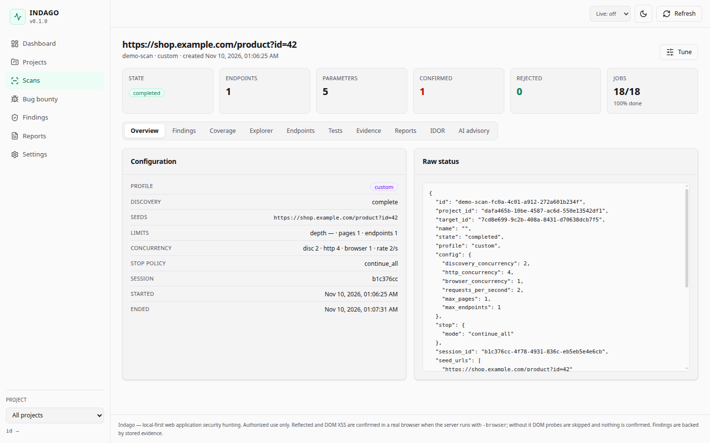
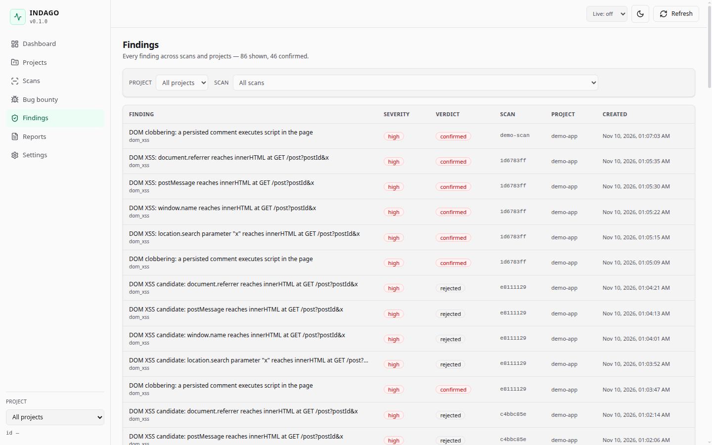
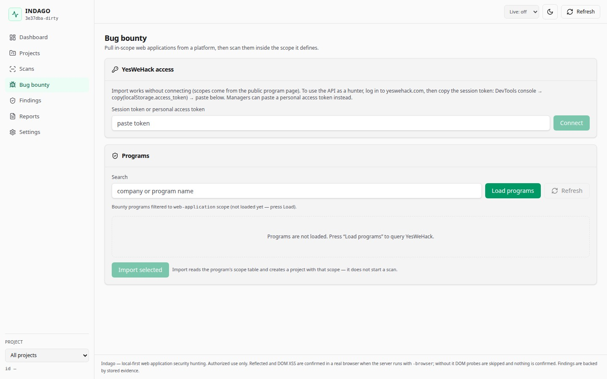
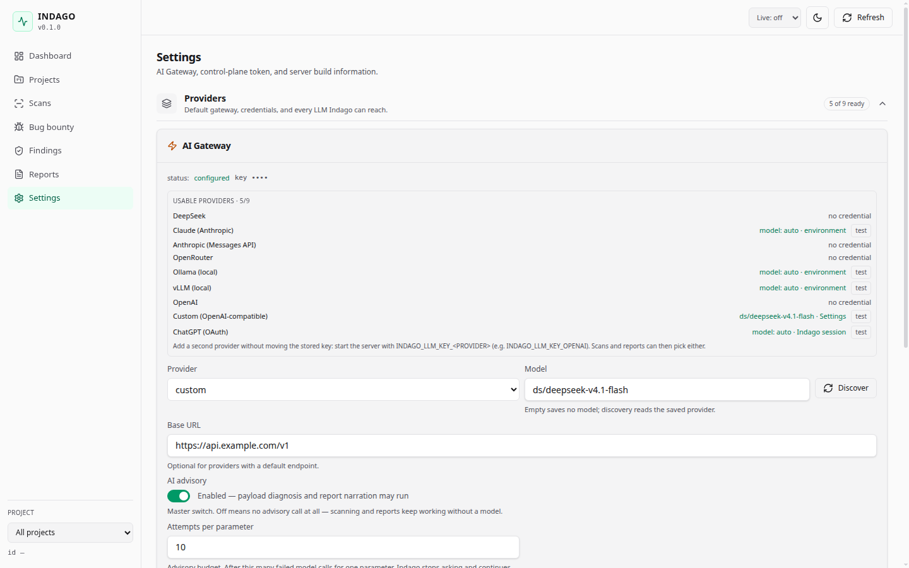

# Indago

**Local-first, verification-first web application security hunting.**

Indago is a single-user platform for authorized web security testing. It
discovers an application, tests it with bounded benign markers, and only calls
a finding **confirmed** when the target itself produces the execution evidence.
Everything runs on your machine: the database, evidence, reports and optional
AI gateway all live under one data directory.

[](https://github.com/xcupi/indago/actions/workflows/ci.yml)

> **Authorized use only.** Run Indago only against systems you own or have
> explicit written permission to test. Scope is mandatory and enforced on every
> request, redirect and browser context.



---

## Target read-only mode

The served application keeps projects, scan history, evidence, reports, and API
settings in the local workspace. To collect new target evidence, open the
project and use **Read-only snapshot**. Confirm the exact scoped URL is a read
operation and, when needed, select a previously saved session from a read-only
account.

A capture sends one bodyless GET and records the response status, content type,
capture time, and SHA-256 of the captured bytes. Redirects are returned as
evidence and require their own approval. Text can be inspected in Indago or
downloaded as JSON for offline review. The preview displays captured markup as
text, with no target scripts, assets, or forms running.

Active scan execution, interactive or password target login, and remote bounty
draft writes are blocked in this mode. Existing reports can still be exported
locally. Browsing historical scan data does not rerun the scan.

[Historical validation and prior scan coverage](docs/feature-review.md) documents
the build and limitations of older results.

## Screenshots

| Scan overview | Findings |
| --- | --- |
|  |  |

| Bug bounty import | Settings |
| --- | --- |
|  |  |

---

## Quick start

Build with Go 1.26 and Node 24. Chromium is optional for local PDF export.

```bash
make ui-install
make ui
make build
./bin/indago db init
./bin/indago serve
```

Open <http://127.0.0.1:8750> and create or select a project. Define its exact
scope, then open **Read-only snapshot** to approve a URL and capture it. For
authenticated reads, import an existing browser session from a read-only
account. Leave the session selector at **Anonymous** for public data.

Use **Scans**, **Findings**, and **Reports** to inspect historical results and
generate local reports. New snapshots can be downloaded from the project and
opened again as local text without contacting any target.

---

## Reports

Formats: **JSON**, **Markdown**, **HTML**, **SARIF**, **PDF**.

Templates: **technical**, **pentest**, **bug bounty**, **YesWeHack**. The
YesWeHack template is intentionally markdown-only and includes the fields a
program expects. Report generation can include confirmed findings only, all
findings, or a selected subset.

---

## AI gateway (optional)

Settings offers DeepSeek, Claude, OpenAI, OpenRouter, and Google AI (Gemini)
with API-key authentication. Claude, OpenAI, OpenRouter, and Google AI can draft
executive summaries for reports. Settings shows a masked hint for the saved key.

The gateway is advisory:

- it never changes a verdict, severity or ordering;
- it is not asked about parameters that are already confirmed;
- it is disabled with one toggle;
- token usage is recorded per AI task.

Settings retains each provider's key and model when you switch the default.
Provider keys can also be supplied through `INDAGO_LLM_KEY_<PROVIDER>` environment
variables.

---

## Bug bounty workflow

The **Bug bounty** page can search YesWeHack programs, inspect public scopes and
rules, and import a program as a project with scope and targets. Importing does
not start a scan. Submission remains a manual step; Indago prepares the report
in the platform's template rather than posting it for you.

Scope can always be entered manually when a program is not imported. Manual
scope stays first-class and is never overwritten by an import.

---

## Architecture

```
Target / Scope
  → Authentication (anonymous / saved session / interactive login)
  → Discovery (HTTP + browser)
  → Endpoint and parameter registry
  → Persistent job queue ⇄ concurrent workers
      → HTTP engine
      → Browser engine
      → Detection engine
      → Verification
  → Finding + evidence
  → Reports
  → Optional AI advisory
```

Read the design docs:

- [`docs/architecture.md`](docs/architecture.md) — components and data flow
- [`docs/domain-model.md`](docs/domain-model.md) — entities and lifecycles
- [`docs/state-machines.md`](docs/state-machines.md) — scan/job/session/finding states
- [`docs/scan-orchestration.md`](docs/scan-orchestration.md) — how a scan runs
- [`docs/scope-semantics.md`](docs/scope-semantics.md) — what scope permits
- [`docs/dom-xss.md`](docs/dom-xss.md) — DOM source/sink model and limits
- [`docs/reports.md`](docs/reports.md) — report formats and templates
- [`docs/ai.md`](docs/ai.md) — providers, API keys, advisory boundaries
- [`docs/bounty.md`](docs/bounty.md) — YesWeHack import and submission
- [`docs/oast.md`](docs/oast.md) — built-in OAST collaborator (`-oast-addr`) and its poll API
- [`docs/feature-review.md`](docs/feature-review.md) — historical validation and coverage limitations

---

## Development

```bash
make check      # gofmt + go vet + go test ./...
make build
make ui         # rebuild the embedded SPA after web/ changes
```

Frontend stack: TypeScript, React, Vite, Tailwind CSS and shadcn-style
primitives under `web/`.

CI rebuilds the frontend from the lockfile, checks that the embedded bundle
matches, and runs the Go quality gate. The container also builds its frontend
from source. The `docker-sandbox` job verifies Chromium's process sandbox using local PDF
exports from the shipped image. See [`.github/workflows/ci.yml`](.github/workflows/ci.yml).

Deployment (TLS, API token, Docker, retention) is documented in
[`docs/deployment.md`](docs/deployment.md).

---

## Data and privacy

Everything is local:

```
data/
  indago.db        SQLite (projects, scans, jobs, findings, tests)
  evidence/        request/response blobs, browser screenshots
  reports/         generated reports
  llm/             provider configuration (keys stored 0600)
  auth/            saved browser sessions for scans
```

Those directories are runtime data, not source. Never commit them. The
repository's `.gitignore` excludes the data directory, databases, environment
files and SPA dependencies.

---

## Project

- [Security policy](SECURITY.md) — authorized use and private vulnerability reporting
- [Changelog](CHANGELOG.md) — what changed in each release
- [License](LICENSE) — MIT
