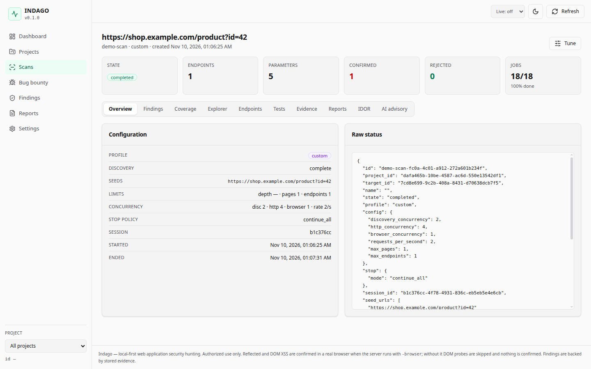
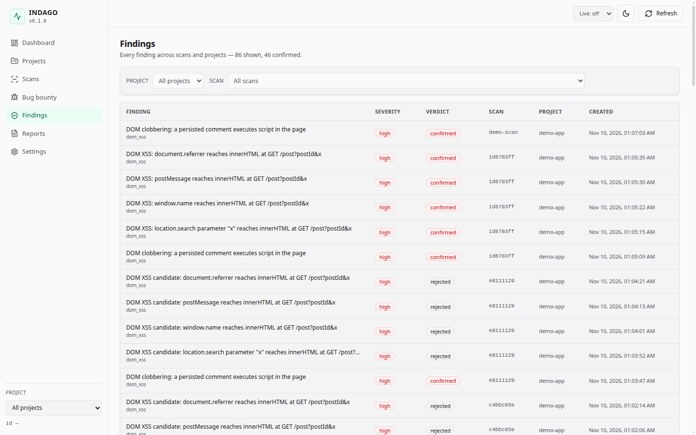
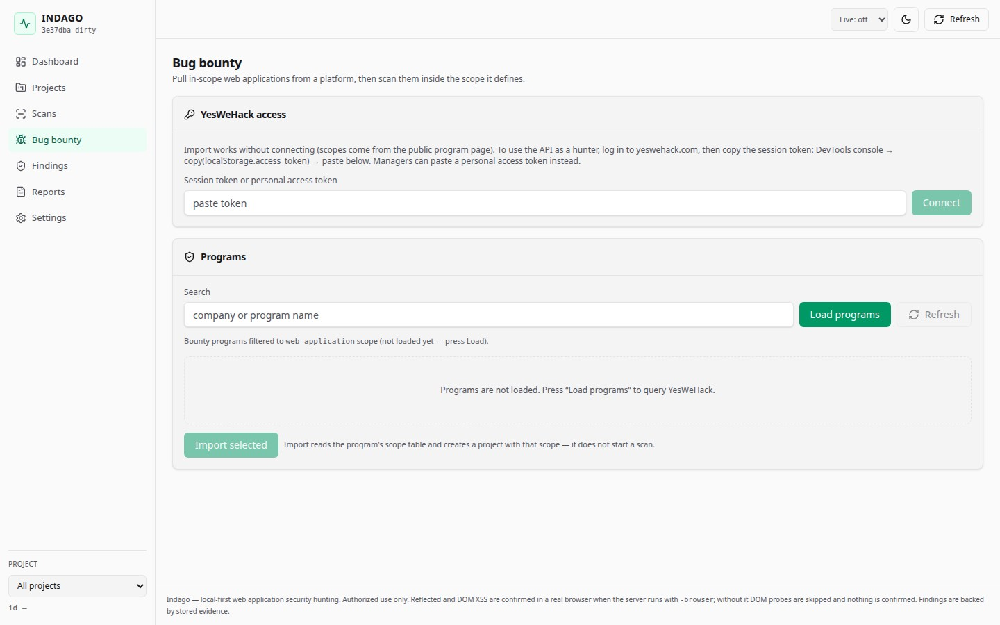
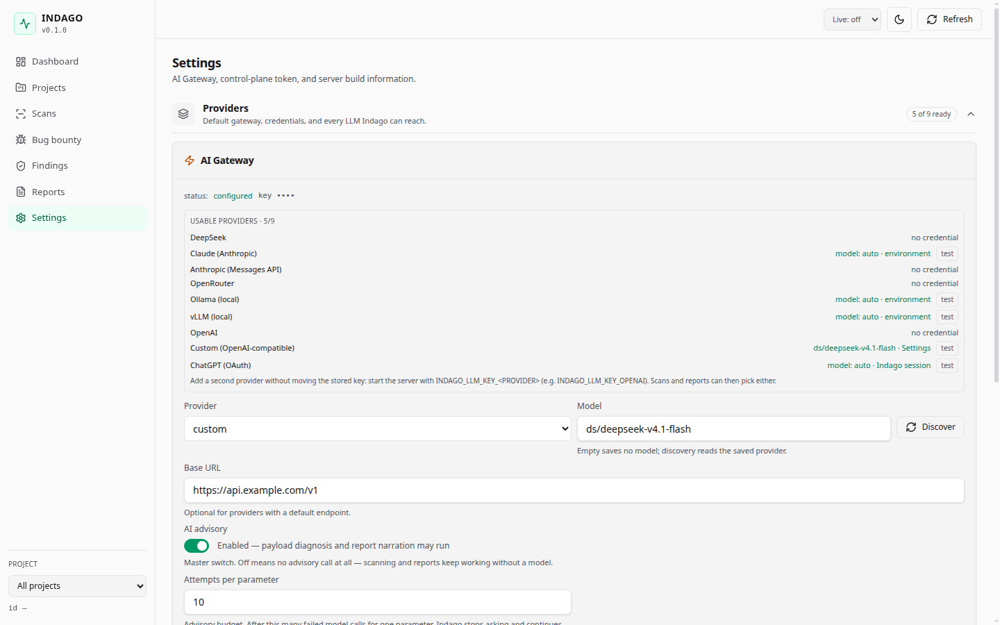

# Indago

**Local-first, verification-first web application security hunting.**

Indago is a single-user platform for authorized web security testing. It
discovers an application, tests it with bounded benign markers, and only calls
a finding **confirmed** when the target itself produces the execution evidence.
Everything runs on your machine: the database, evidence, reports and optional
AI gateway all live under one data directory.

[](https://github.com/xcupi/indago/actions/workflows/ci.yml)

> **Authorized use only.** Run Indago only against systems you own or have
> explicit written permission to test. Scope is mandatory and enforced on every
> request, redirect and browser context.



---

## What it does

| Area | Coverage |
| --- | --- |
| **Reflected XSS** | Parameter discovery, context-aware payload selection, browser marker execution, bounded filter-bypass fallback |
| **DOM XSS** | `location.*`, `document.referrer`, `window.name`, `postMessage`, `JSON.parse` taint; `innerHTML`, `outerHTML`, `document.write`, `insertAdjacentHTML`, `Range.createContextualFragment`, navigation/`src` sinks, `document.cookie`, string timers |
| **DOM clobbering** | Clobbering-to-XSS and attribute-filter bypass, confirmed in a real browser |
| **Open redirect** | Server-side and client-side `location` assignment, with a scope-checked navigation proof |
| **Access control** | Role/identity differentials, forced browsing, method and path bypasses, response-cookie continuity, page disclosure |
| **IDOR** | ID harvesting, object-family enumeration, redirect/body leak checks, automatic confirmation |
| **Information disclosure** | `.git` history, backup/config files, verbose errors, TRACE/IP headers, HTML comments |
| **Discovery** | Crawl, forms, sitemap/robots, wordlists, JavaScript/network observation, parameter mining |
| **Evidence** | Request/response blobs, browser signals, screenshots, per-finding provenance, standalone PoC |
| **Reports** | JSON, Markdown, HTML, PDF; `technical`, `pentest`, `bug_bounty`, `yeswehack` templates |
| **Bug bounty** | YesWeHack program search, public scope/rules import, project creation, submission template |
| **AI advisory** | Optional multi-provider assistant for payload diagnosis, triage and report narration; never changes a verdict |

Validation against the PortSwigger Web Security Academy catalogue is tracked in
[`docs/feature-review.md`](docs/feature-review.md): **48 of 55 catalogued labs
confirmed by the engine**, with the remaining seven XSS/exploit-chain labs
documented as out of scope.

---

## Screenshots

| Scan overview | Findings |
| --- | --- |
|  |  |

| Bug bounty import | Settings |
| --- | --- |
|  |  |

---

## Why Indago

- **Scope first.** A project scope is required before any request. Redirects,
  browser navigations and login flows are checked against it, not just the
  initial URL.
- **Evidence, not reflections.** A marker appearing in a response is a
  candidate. Confirmation needs a marker-specific runtime signal from a real
  browser (or an equivalent server-side proof for the relevant class).
- **Honest verdicts.** Findings are `confirmed`, `inconclusive`, `rejected`,
  `pending` or a documented gap. The scanner does not promote a lab or a
  hypothesis without its own evidence.
- **Local by default.** SQLite, evidence and reports stay under `./data`.
  There is no telemetry and no cloud dependency. The AI gateway is off until
  you configure it, and it is advisory only.
- **Bounded behavior.** Conservative rate/concurrency defaults, explicit
  `-allow-state-changing` opt-in, no CAPTCHA solving, no identity rotation, no
  weaponized payloads.

---

## Quick start

Requirements:

- Go 1.26+ (the module is pinned to 1.26 and CI builds with the version in
  `go.mod`)
- Node 24 + npm for the SPA
- Chromium/Chrome for browser discovery and DOM verification

```bash
git clone https://github.com/xcupi/indago.git
cd indago

make ui-install     # first checkout, or after changing web/
make ui             # rebuild the embedded SPA
make build          # produces ./bin/indago

./bin/indago db init
./bin/indago serve -browser
```

Open <http://127.0.0.1:8750>. The SPA is embedded in the binary; the API is on
the same origin.

For browser-backed scans, point Indago at Chromium if it is not on `PATH`:

```bash
INDAGO_CHROMIUM_PATH=/usr/bin/google-chrome ./bin/indago serve -browser
```

### A scan from the CLI

The CLI talks to the running server. Scope is mandatory:

```bash
./bin/indago project create "Acme store"
./bin/indago scope set -project <PID> -include shop.example.com -include-path /app
./bin/indago target add -project <PID> -name store -url https://shop.example.com/app
./bin/indago scan create -project <PID> -target <TID> -profile conservative
./bin/indago scan start <SCAN>
./bin/indago scan status <SCAN>
./bin/indago finding list -scan <SCAN>
./bin/indago report create -scan <SCAN> -format html -template technical -out report.html
```

Use `-allow-state-changing` only when you intend to exercise POST/PUT/PATCH/
DELETE endpoints. Use `-browser` for DOM XSS, browser discovery and browser
verification; without it those probes are skipped rather than guessed.

### Web UI workflow

1. **Projects → New project**, then open the project.
2. **Scope** — include hosts and optional path prefixes; fail-closed.
3. **Scan login** (optional) — for targets that need an account, log in through
   a visible browser once; the Playwright session is saved on the project and
   new scans pick it up automatically.
4. **New scan** — choose target, profile, seeds and limits; start.
5. Inspect **Findings / Coverage / Explorer / Tests / Evidence** while it runs.
6. Generate a report, or import a bug-bounty program and use its scope.

---

## Finding classes and verification

| Class | Confirmation signal |
| --- | --- |
| Reflected XSS | Marker executes in the browser at the reflected context |
| DOM XSS | Marker reaches the modelled sink and executes in the page/frame |
| DOM clobbering | Persisted markup clobbers the modelled global and changes execution |
| Open redirect | The page's own handler navigates to an out-of-origin URL |
| Access control | Differential response for a lower-privilege identity, with a stable endpoint and body signal |
| IDOR | Another object is readable through the same authorized request shape |
| Information disclosure | The disclosed content is retrieved and matched to the expected artifact |

A finding carries its request/response evidence, the verification signal, a
severity and a verdict. Reports can regenerate from stored evidence without
re-running the scan.

---

## Reports

Formats: **JSON**, **Markdown**, **HTML**, **PDF**.

Templates: **technical**, **pentest**, **bug bounty**, **YesWeHack**. The
YesWeHack template is intentionally markdown-only and includes the fields a
program expects. Report generation can include confirmed findings only, all
findings, or a selected subset.

---

## AI gateway (optional)

Indago supports nine provider ids: `deepseek`, `openai`, `anthropic`, `claude`,
`chatgpt`, `openrouter`, `ollama`, `vllm`, `custom`. Settings groups provider
configuration, OAuth sessions and workspace details into collapsible sections.
A saved key is never echoed back; the UI only shows a masked hint.

The gateway is advisory:

- it never changes a verdict, severity or ordering;
- it is not asked about parameters that are already confirmed;
- it is disabled with one toggle;
- token usage is recorded per AI task.

Provider keys can also be supplied as `INDAGO_LLM_KEY_<PROVIDER>` environment
variables. Claude and ChatGPT subscription OAuth sessions are stored under the
data directory with owner-only permissions.

---

## Bug bounty workflow

The **Bug bounty** page can search YesWeHack programs, inspect public scopes and
rules, and import a program as a project with scope and targets. Importing does
not start a scan. Submission remains a manual step; Indago prepares the report
in the platform's template rather than posting it for you.

Scope can always be entered manually when a program is not imported. Manual
scope stays first-class and is never overwritten by an import.

---

## Architecture

```
Target / Scope
  → Authentication (anonymous / saved session / interactive login)
  → Discovery (HTTP + browser)
  → Endpoint and parameter registry
  → Persistent job queue ⇄ concurrent workers
      → HTTP engine
      → Browser engine
      → Detection engine
      → Verification
  → Finding + evidence
  → Reports
  → Optional AI advisory
```

Read the design docs:

- [`docs/architecture.md`](docs/architecture.md) — components and data flow
- [`docs/domain-model.md`](docs/domain-model.md) — entities and lifecycles
- [`docs/state-machines.md`](docs/state-machines.md) — scan/job/session/finding states
- [`docs/scan-orchestration.md`](docs/scan-orchestration.md) — how a scan runs
- [`docs/scope-semantics.md`](docs/scope-semantics.md) — what scope permits
- [`docs/dom-xss.md`](docs/dom-xss.md) — DOM source/sink model and limits
- [`docs/reports.md`](docs/reports.md) — report formats and templates
- [`docs/ai.md`](docs/ai.md) — providers, OAuth, advisory boundaries
- [`docs/bounty.md`](docs/bounty.md) — YesWeHack import and submission
- [`docs/feature-review.md`](docs/feature-review.md) — coverage scoreboard and gaps

---

## Development

```bash
make check      # gofmt + go vet + go test ./...
make build
make ui         # rebuild the embedded SPA after web/ changes
```

Frontend stack: TypeScript, React, Vite, Tailwind CSS and shadcn-style
primitives under `web/`.

CI runs the full quality gate and builds the container image; the
`docker-sandbox` job proves Chromium's process sandbox inside the shipped
image. See [`.github/workflows/ci.yml`](.github/workflows/ci.yml).

Deployment (TLS, API token, Docker, retention) is documented in
[`docs/deployment.md`](docs/deployment.md).

---

## Data and privacy

Everything is local:

```
data/
  indago.db        SQLite (projects, scans, jobs, findings, tests)
  evidence/        request/response blobs, browser screenshots
  reports/         generated reports
  llm/             provider configuration (keys stored 0600)
  claude/          Claude OAuth credential (0600)
  chatgpt/         ChatGPT OAuth credential (0600)
  auth/            saved browser sessions for scans
```

Those directories are runtime data, not source. Never commit them. The
repository's `.gitignore` excludes the data directory, databases, environment
files and SPA dependencies.

---

## Project

- [Security policy](SECURITY.md) — authorized use and private vulnerability reporting
- [Changelog](CHANGELOG.md) — what changed in each release
- [License](LICENSE) — MIT
